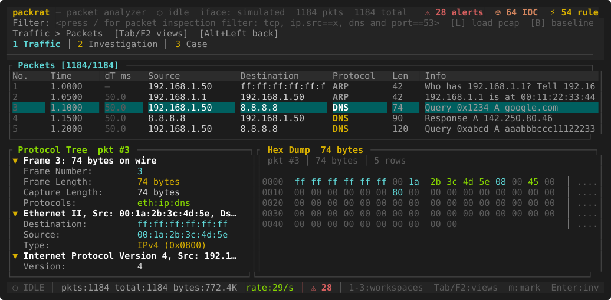
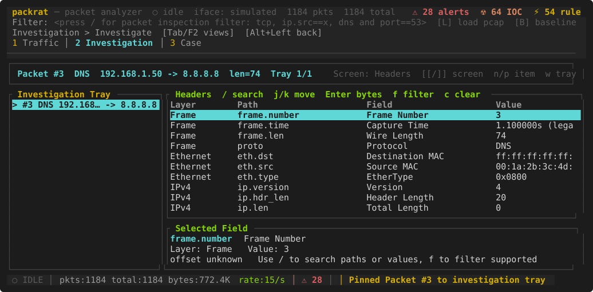
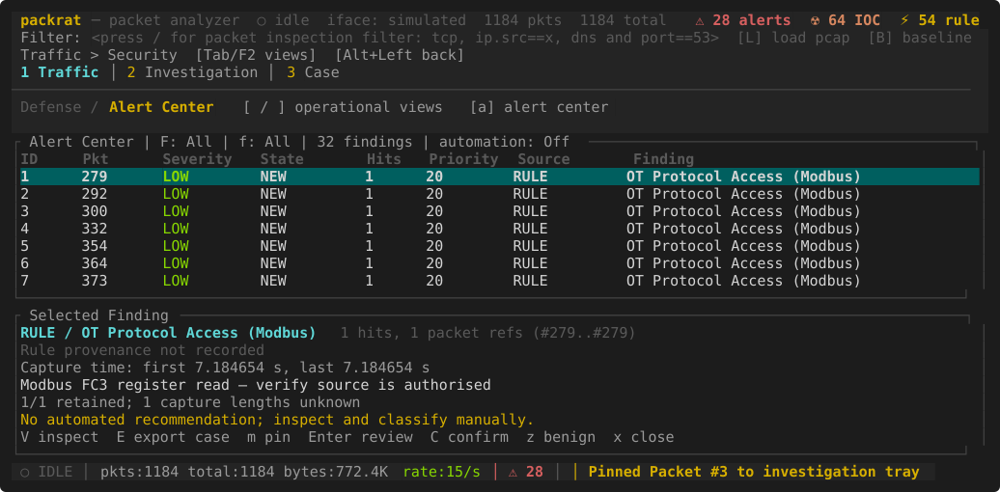

# 🐀 PACKRAT

**A keyboard-first network analyzer for packet inspection, incident triage, and evidence review.**

Follow a finding from the alert that flagged it to the original packets, decoded
headers, reconstructed conversation, and exported case. Packrat runs in a local
terminal or over SSH. Its detections use inspectable protocol logic, correlation
windows, IOC/YARA matches, and operator-authored rules.



<details>
<summary>Investigation workspace and Alert Center</summary>





</details>

Screenshots use the built-in simulation, not live traffic.

## Workflow:

```text
LIVE TRAFFIC
    |
    +-- packet fields / bytes / VLAN stack / protocol decode
    +-- TCP streams / IPv6 fragments / TLS, DTLS and QUIC context
    +-- hosts / services / processes / carved objects
    |
CORRELATED FINDINGS
    |
    +-- IDS / ARP / authentication / DNS / TLS / IOC / YARA / rules
    +-- hit count / first evidence / last evidence / analyst disposition
    |
CASE EVIDENCE ----------------------> CONTROLLED RESPONSE
```

Packets, streams, hosts, alerts, objects, graph nodes, and notes can be pinned
to one investigation tray. Move between packet headers, bytes, flow context,
strings, encrypted-traffic metadata, and security evidence without losing the
selected artifact or stopping capture.

## What Packrat Does

| Stage | Capability |
|---|---|
| **Capture** | Real interfaces, explicit simulation, PCAP import/replay, privileged capture helper |
| **Inspect** | Header tree, byte interpretation, packet comparison, VLAN/QinQ inspection, object carving |
| **Reconstruct** | Out-of-order TCP streams, IPv4/IPv6 fragment integrity, searchable bidirectional payloads |
| **Understand encryption** | TLS/DTLS/QUIC metadata, JA3/JA3S/JA4/RatQ context, key-log and authenticated helper hooks |
| **Detect** | Stateful IDS, scans, spoofing, DHCP/DNS abuse, HTTP smuggling, industrial-policy violations, credential exposure |
| **Correlate** | Unified Alert Center, IOC/YARA/rule findings, host and service graph, explainable risk scoring |
| **Preserve** | Capture-scoped alert evidence, bounded selective archives, notebook, portable projects and PCAPNG case exports |
| **Respond** | Monitor, preview, approved manual, or policy-gated automatic Linux nftables containment |

## Installation

Run the Cargo commands below from the repository root. Cargo installs the
executables in `~/.cargo/bin` by default. Add that directory to your PATH if
your shell cannot find `packrat`.

### Simulation

Simulation uses built-in traffic and requires no packet-capture library.

```bash
cargo install --locked --path . --bin packrat
packrat --simulation
```

### Live capture

Live capture is the default runtime mode. Install libpcap or Npcap for your
platform as described in [BUILD.md](BUILD.md), then enable the `real-capture`
feature.

```bash
cargo install --locked --path . --features real-capture \
  --bin packrat --bin packrat-capture-helper
```

#### Live capture without sudo on Linux

Use sudo for the one-time setup. The dedicated helper gets `CAP_NET_RAW`, and
the Packrat TUI runs as your regular user. The helper is owned by root and can
be run by members of your primary group. Use a private group if capture access
should be limited to your account.

```bash
helper=/usr/local/libexec/packrat/packrat-capture-helper
sudo install -d -o root -g root -m 0755 /usr/local/libexec/packrat
sudo install -o root -g "$(id -gn)" -m 0750 \
  "$HOME/.cargo/bin/packrat-capture-helper" "$helper"
sudo setcap cap_net_raw=ep "$helper"
packrat --capture-helper "$helper"
```

In the interface selector, use `j` or `k` to choose an interface and press
`Enter` to start capture. After updating Packrat, repeat the `sudo install`
and `sudo setcap` commands to update the privileged copy.

To use the helper whenever you run plain `packrat`, put the following launcher
in `~/.local/bin/packrat` and make it executable with
`chmod +x ~/.local/bin/packrat`.

```sh
#!/bin/sh
packrat="$HOME/.cargo/bin/packrat"

# Offline project review takes standalone arguments.
for argument in "$@"; do
    if [ "$argument" = "--project" ]; then
        exec "$packrat" "$@"
    fi
done

exec "$packrat" --capture-helper /usr/local/libexec/packrat/packrat-capture-helper "$@"
```

Put `~/.local/bin` ahead of `~/.cargo/bin` in your PATH. If Bash cached the
original command location, run `hash -r`.

See [BUILD.md](BUILD.md) for Linux, macOS, Windows/Npcap, cross-compilation,
eBPF socket attribution, and troubleshooting instructions.

## Operator Workflow

Packrat groups the interface into three workspaces:

| Key | Workspace | Primary views |
|---|---|---|
| `1` | **Traffic** | Packets, flows, hosts, TLS analysis, Security and Alert Center |
| `2` | **Investigation** | Investigation tray, analysis, strings, visualization, workbench, objects, diff, evidence graph |
| `3` | **Case** | Notebook, runtime timeline, local rules, and network utilities |

Core controls:

| Key | Action |
|---|---|
| `Tab` / `F2` | Open the current workspace's view drawer |
| `End`, then `Enter` in the drawer | Open About and see the installed build's version |
| `Esc` | Close a window or return to the workspace home |
| `Alt+Left` | Return to the previous screen |
| `Ctrl+P` / `?` | Search packets, hosts, and findings |
| `m` / `M` | Pin selected evidence or current context to the investigation tray |
| `Enter` on a packet | Open the selected packet in Investigation |
| `[` / `]` and `n` / `p` in Investigation | Change views without losing the packet, or move to another packet in the tray |
| `S`, then `a` | Open Alert Center |
| `V` / `E` in Alert Center | Investigate cited packets or export a scoped case |
| `,` | Open persistent Preferences |
| `h` from the packet list | Open the scrollable keyboard reference |
| `X` | Export the current case bundle |
| `!` | Revoke active Guard blocks and force monitor mode |

## Deterministic Defense

The Alert Center correlates recurring detector output into findings instead of
flooding the operator with one row per packet. Each finding retains occurrence
count, first and last observation times, severity, supporting frames, and analyst
disposition. Findings with rule provenance also show revision, confidence, and a
suggested verification step. In Alert Center, `Enter` starts review, `z` marks
benign, and `C` confirms a finding.

Investigating an alert opens the triggering packet when available and adds its
supporting packets to the tray. Evidence is resolved against the original
capture, including the optional archive after the live buffer rolls over.
Missing, truncated, and unreadable frames are reported explicitly. A finding
is a lead, not proof of compromise.

Watch and Triage modes can pin urgent findings and add fixed, source-specific
review guidance. They never modify firewall policy. TrafficLatch containment is
separate and starts in `monitor` mode.

Automatic containment requires a critical rule explicitly marked for automatic
response or two independent critical detectors for the same attacker and
target. Blocks have short expirations, protected addresses are rejected, active
actions are bounded, and all decisions are audited. The global kill switch
attempts immediate revocation and records any failed revocation until expiry.

## Offline Analysis and Monitoring

- `packrat-analyze --alerts-only capture.pcapng` emits deterministic NDJSON without opening the TUI or changing firewall state. Labeled replay suites can compare alert counts, opening frames, cited evidence, and classifications against a previous analyzer.
- `packrat-archive` inspects saved alerts by capture and session, reports evidence availability and first-review timing, and exports scoped cases. Open a saved case with `packrat --project case.json`.
- `--archive-alert-evidence PATH` retains referenced high and critical alert packets in a bounded archive. Use `--archive-evidence-rule RULE_ID` to opt additional rules into retention. Archived packets and portable cases can contain payloads; treat them as sensitive evidence.
- The health and triage watchers report capture loss, alert persistence failures, archive capacity, stale monitoring, and evidence-check failures. Routine watcher summaries do not include packet payloads.

## Extensibility

- Local packet rules from `~/.config/packrat/rules/`
- IOC feeds and deterministic matching
- YARA scans over carved and reconstructed objects
- Hot-reloaded Lua dissectors
- TOML protocol layouts
- Privilege-separated capture, TLS/QUIC decode, reputation, and containment helpers
- Optional Linux eBPF collector for short-lived socket ownership
- OpenMetrics health and telemetry endpoint

## Build Features

| Cargo feature | Default | Purpose |
|---|---:|---|
| `terminal-ui` | Yes | Build the terminal interface; disable default features for headless tools |
| `real-capture` | No | Enable libpcap/Npcap capture and the capture helper |
| `ebpf-sockets` | No | Build the Linux Aya eBPF socket collector |

Useful checks:

```bash
cargo test --locked
cargo check --locked --features real-capture
cargo check --locked --features ebpf-sockets --bin packrat-socket-collector
```

## Documentation

- [User manual](docs/USER_MANUAL.md): investigations, filters, Alert Center, projects, evidence, and Guard
- [Build guide](BUILD.md): dependencies, platform builds, permissions, eBPF, and cross targets
- [Branding and licenses](docs/BRANDING_AND_LICENSES.md): emoji rendering and Matrix-effect license boundaries
- `packrat --help`: authoritative startup option list for the installed version

## Safety Model

Packrat observes by default. Simulation requires `--simulation`; live capture
requires an explicitly built capture feature and operating-system permission;
containment remains monitor-only unless the operator selects another mode.
Use preview mode, protected management addresses, short expirations, and a
privilege-separated helper before enabling response on production networks.

## License

MIT. See [LICENSE](LICENSE).
